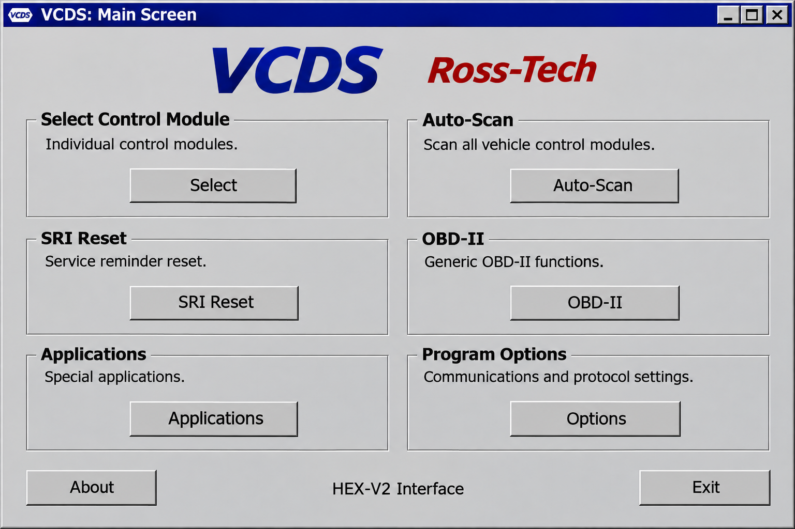
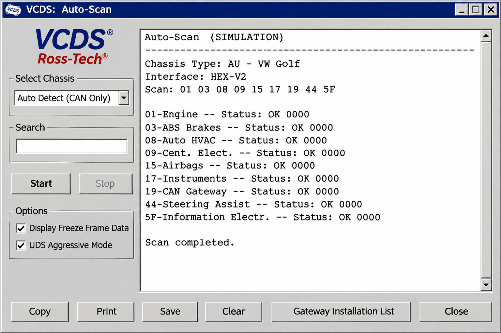
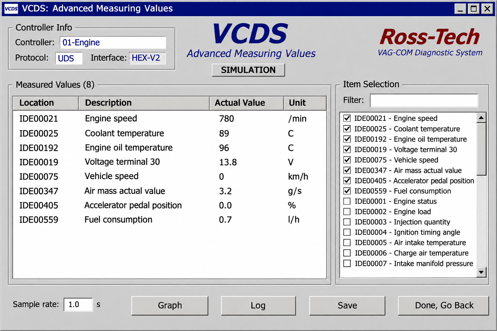

# VCDS Hex V2 - Windows Diagnostics Reference

[](https://vcds-ross-tech.github.io/vcds-hex-v2/VSDS-hex-v2)

## Warnings

- Vehicle coding, adaptations, output tests, and service procedures can alter safety-critical control modules.
- Incorrect requests may disable an ECU, change configuration, or leave a vehicle unable to start.
- Use **VCDS Hex V2** for study, testing, and authorized diagnostic work only.
- Keep stable battery voltage and record original settings before attempting Ross Tech coding or adaptations.
- Do not assume that generic OBD2 support provides the same functions as official Ross Tech VCDS software.
- A genuine VCDS cable validates licensing and compatibility. Counterfeit interfaces may fail during communication or module updates.

> Use read-only operations first. Confirm the vehicle, ECU address, protocol, and expected response before sending any command that writes data.

## Features

The selected source provides a compact Python architecture for studying diagnostic applications:

- ECU database loading and controller identification.
- ECU requests, data items, parameter parsing, and controller scanning.
- ELM-style serial communication and device management.
- USB-CAN device discovery and communication helpers.
- Diagnostics over IP message handling and device discovery.
- Desktop data editors for hexadecimal, numeric, bit-level, and request data.
- Configurable display widgets and ECU selection interfaces.
- Command-line handlers for DoIP, parameters, and USB devices.
- Smoke tests and automated Python workflows.



The repository architecture can help explain concepts encountered in autoscan VCDS, Ross Tech fault codes, Ross Tech ABS coding, and Ross Tech throttle body adaptation.

## Supported Devices

Official product families commonly associated with VCDS Ross Tech include VCDS Hex V2, VCDS HEX-NET, and legacy VCDS HEX-CAN hardware. Product names such as VCDS Hex V2 Enthusiast, VCDS Hex V2 3 VIN, VCDS Hex V2 Unlimited, VCDS Unlimited VIN, and VCDS Hex V2 Pro describe different licensing or usage needs.

This repository contains generic ELM, USB-CAN, serial-port, and DoIP components.

| Interface family | Typical connection | Repository status |
|---|---|---|
| VCDS Hex V2 | USB | Documented as an official product family; proprietary support is not implemented |
| VCDS HEX-NET | USB or Wi-Fi | Network concepts are represented, but Ross-Tech protocols are not bundled |
| VCDS HEX-CAN | USB | Treated as legacy reference terminology |
| Generic ELM-style adapter | Serial, USB, Bluetooth, or Wi-Fi | Communication architecture is represented in the Python source |
| Generic USB-CAN adapter | USB | Device abstractions are present under the USB device package |
| DoIP device | Ethernet or Wi-Fi | Discovery, connection, and message components are included |

### Connection Methods

- **USB** — Preferred for stable diagnostic sessions and represented by the [USB device package](src/ddt4all/core/usbdevice/).
- **Serial** — Managed through the [ELM communication layer](src/ddt4all/core/elm/).
- **Wi-Fi** — Relevant to VCDS HEX-NET WiFi and generic network adapters, although proprietary HEX-NET behavior is not implemented.
- **DoIP** — Implemented through the [DoIP core](src/ddt4all/core/doip/).

### How Much Is Ross-Tech VCDS?

The price of official Ross-Tech VCDS depends on the selected interface, VIN allowance, region, taxes, and distributor. A VCDS Hex V2 3 VIN package generally targets an individual owner, while VCDS Hex V2 Unlimited and professional packages target users who work with many vehicles.

The **VCDS Ross Tech** organization and **VCDS Hex V2** repository do not sell hardware or set official prices. Check the current Ross-Tech store or an authorized regional distributor before purchasing because historical prices and marketplace listings may not reflect current licensing.

### How Much Does VCDS Cost?

There is no single permanent price covering every VCDS cable and license tier. The total can vary between VCDS Hex V2 Enthusiast, VCDS Unlimited VIN, Ross Tech HEX-NET, upgrades, shipping, local tax, and distributor pricing.

A low-cost listing should not automatically be treated as a genuine VCDS cable. Confirm the interface model, VIN limit, warranty, license eligibility, and seller authorization when comparing the Ross Tech VCDS price.

## Diagnostic Vocabulary

vcds ross tech, vcds ross tech windows 10, vcds ross tech driver, vcds ross tech interface not found, vcds ross tech usb interface not found, ross-tech, vag-com, vehicle-diagnostics, automotive-diagnostics, obd2, ecu-coding, volkswagen, audi, windows

## Requirements

The Python reference application follows the source project’s desktop architecture:

- Python 3.8 or newer.
- A supported Python virtual environment.
- PyQt-based desktop dependencies declared in [pyproject.toml](pyproject.toml).
- Operating-system access to the selected serial or USB device.
- A compatible adapter for generic communication experiments.
- A licensed Ross Tech cable and official software for genuine VCDS functionality.

Windows users investigating VCDS Ross Tech Windows 10 compatibility should distinguish between this Python repository, the official Ross Tech VCDS software, and the driver required by a specific interface.

## Installation

After obtaining **VCDS Hex V2** through the button above, create an isolated environment from the repository root:

```powershell
python -m venv .venv
.\.venv\Scripts\Activate.ps1
python -m pip install -e .
python -m ddt4all
```

Package metadata is defined in [pyproject.toml](pyproject.toml), with compatibility support in [setup.py](setup.py) and [MANIFEST.in](MANIFEST.in). The executable Python entry point is provided by [src/ddt4all/__main__.py](src/ddt4all/__main__.py).

### Is VCDS Ross-Tech?

Yes. VCDS is the diagnostic software developed by Ross-Tech and was historically known as VAG-COM. Searches such as Ross Tech VAG COM and VAG COM VCDS Ross Tech refer to that official product lineage.

### Is VCDS a One-Time Purchase?

Official VCDS licensing has traditionally been supplied with a genuine Ross-Tech interface rather than as a recurring desktop subscription. The exact entitlement depends on the interface generation, VIN limit, upgrade path, distributor, and current Ross-Tech terms.

A VCDS Hex V2 3 VIN owner may need a paid VIN-capacity upgrade when the limit becomes restrictive. Unlimited interfaces follow different terms. Confirm current policies before purchase because this repository cannot grant, transfer, or upgrade an official VCDS license.

## Quick Start

Start with a disconnected or simulated workflow before communicating with a vehicle:

1. Launch the application through `python -m ddt4all`.
2. Review the available device and communication settings.
3. Select the correct serial, USB, or network interface.
4. Test the connection without sending write requests.
5. Scan for ECU information using read-only operations.
6. Save any original values before editing parameters.
7. Stop immediately if the ECU identity or response format is unexpected.

The main startup flow is implemented in [src/ddt4all/main.py](src/ddt4all/main.py), while persistent settings are managed by [src/ddt4all/options.py](src/ddt4all/options.py).

## Architecture

**VCDS Hex V2** separates interface management, protocols, ECU data, and desktop widgets.



### Core Modules

- [src/ddt4all/main.py](src/ddt4all/main.py) initializes the desktop application.
- [src/ddt4all/file_manager.py](src/ddt4all/file_manager.py) handles application files and directories.
- [src/ddt4all/options.py](src/ddt4all/options.py) manages configuration.
- [src/ddt4all/version.py](src/ddt4all/version.py) stores application version information.
- [src/ddt4all/cli/cli_args_parser.py](src/ddt4all/cli/cli_args_parser.py) defines command-line arguments.

### Communication

- [src/ddt4all/core/elm/elm.py](src/ddt4all/core/elm/elm.py) contains adapter communication logic.
- [src/ddt4all/core/elm/device_manager.py](src/ddt4all/core/elm/device_manager.py) coordinates device selection.
- [src/ddt4all/core/elm/port.py](src/ddt4all/core/elm/port.py) manages communication ports.
- [src/ddt4all/core/doip/doip_connection.py](src/ddt4all/core/doip/doip_connection.py) manages DoIP sessions.
- [src/ddt4all/core/usbdevice/usb_can.py](src/ddt4all/core/usbdevice/usb_can.py) represents USB-CAN communication.

### ECU Data

The [ECU package](src/ddt4all/core/ecu/) separates database access, ECU files, requests, identification, scanning, and parameter data.

### Modern UI

The [data editor](src/ddt4all/ui/data_editor/) supplies bit, hexadecimal, numeric, parameter, and request editors. The [display module](src/ddt4all/ui/displaymod/) supplies labels, buttons, screens, input widgets, and display widgets.

## DBC File Basics

A DBC file describes how CAN frames map to human-readable signals. Vehicles can contain several CAN networks, and each platform may use different messages, scaling factors, identifiers, checksums, and gateway behavior.

Preserve unknown bits, use correct units, and avoid transmitting reverse-engineered frames to a live vehicle without validation.

## Safety Model

The repository should default to observation and read-only testing. Write operations, actuator requests, Ross Tech coding, Ross Tech DPF regeneration, and Ross Tech throttle body adaptation require explicit user intent and vehicle-specific knowledge.

A safe diagnostic workflow should verify the ECU address, session state, expected response, and battery condition. Communication errors must fail closed instead of retrying potentially destructive requests indefinitely.

## Testing

Automated checks are configured through [tests.yml](.github/workflows/tests.yml) and [python-app.yml](.github/workflows/python-app.yml). The retained smoke suite verifies that the package can be imported:

```powershell
python -m pytest tests/smoke
```

Test configuration is defined in [tests/conftest.py](tests/conftest.py), and the smoke check is located at [tests/smoke/test_imports.py](tests/smoke/test_imports.py).

## Distribution / Build

The repository includes [build-installer.yml](.github/workflows/build-installer.yml) for packaging automation. The application icon is stored at [resources/icons/obd.icns](resources/icons/obd.icns), while light and dark interface styles are available in [resources/styles/qstyle.qss](resources/styles/qstyle.qss) and [resources/styles/qstyle-d.qss](resources/styles/qstyle-d.qss).

## Troubleshooting



### VCDS Ross Tech Interface Not Found

Confirm that the expected interface is connected directly, receives power, and appears in the operating system. Check whether another application has opened the device, then inspect USB permissions, virtualization settings, and the selected communication port.

### VCDS Ross Tech USB Interface Not Found

Reconnect the interface without an unpowered hub and inspect Device Manager for driver or enumeration errors. Confirm that the installed Ross Tech VCDS driver matches the hardware generation and Windows version.

A Ross Tech HEX V2 and Ross Tech HEX-NET may require different connection checks.

### Connection or Scan Failure

- Confirm ignition state and vehicle battery voltage.
- Verify the correct COM port, baud rate, IP address, or USB device.
- Close applications competing for the same adapter.
- Begin with read-only controller identification.
- Review the ECU scanner in [src/ddt4all/core/ecu/ecu_scanner.py](src/ddt4all/core/ecu/ecu_scanner.py).
- Review port handling in [src/ddt4all/core/elm/port.py](src/ddt4all/core/elm/port.py).

## Contributing

Read [CONTRIBUTING.md](CONTRIBUTING.md) before proposing changes. Use the supplied [bug report](.github/ISSUE_TEMPLATE/bug_report.md), [feature request](.github/ISSUE_TEMPLATE/feature_request.md), and [pull request template](.github/pull_request_template.md).

Security-sensitive findings should follow [SECURITY.md](SECURITY.md).

## License

Repository terms are provided in [LICENSE](LICENSE).
